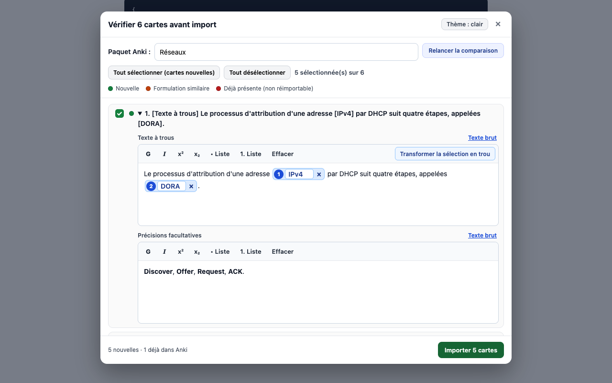
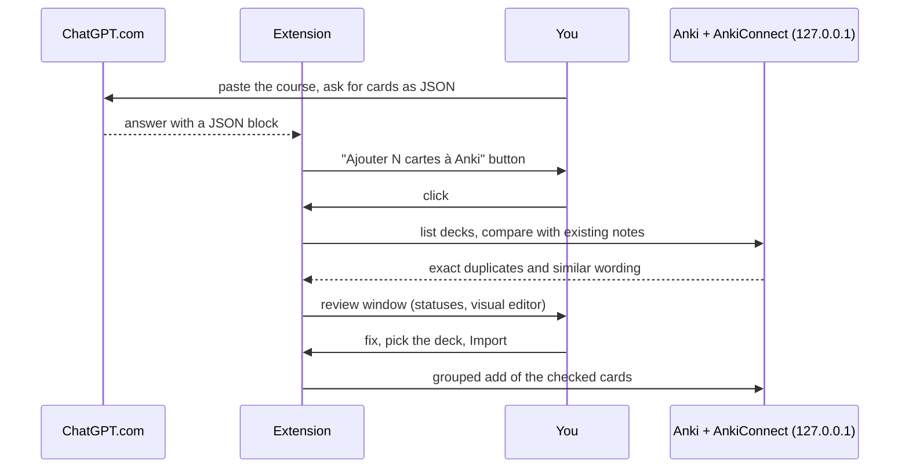

<div align="center">

[](README.md)


# Cartes vers Anki

**Import the cards ChatGPT generates into Anki, in one click.**<br>
A button appears under the answer, you review the cards, duplicates are caught before the import. Everything stays on your computer.

[](LICENSE)
[](https://chromewebstore.google.com/detail/fhkabgkbnknihhdlmcnkmnbijepclipi)
[](extension/manifest.json)
[](#requirements)
[](https://github.com/pyxl-dev/cartes-vers-anki/actions/workflows/tests.yml)

</div>

<p align="center"></p>

The interface and the documentation under `docs/` are in French.

## Why

Asking ChatGPT for revision cards is easy. Getting them into Anki is not: copy JSON, check every card, guess which ones already exist, find the right deck.

Cartes vers Anki does that trip for you. The extension spots the cards in the answer, lets you read and fix them, compares them with your collection, then sends them to the deck you pick.

## How it works



- **A button under ChatGPT's answer**: "Ajouter N cartes à Anki", no JSON copy-paste.
- **Duplicates caught before the import**: exact ones (whole collection) and close wordings (local comparison, no AI).
- **Review and fix** in a visual editor, cloze deletions included.
- **Pick or create the deck**, with accent-tolerant search.
- **100% local**: the extension only talks to AnkiConnect on `127.0.0.1`. No server, no account, no telemetry.

## Install

Easiest: install [Cartes vers Anki from the Chrome Web Store](https://chromewebstore.google.com/detail/fhkabgkbnknihhdlmcnkmnbijepclipi) (Chrome, Brave, Edge). Updates are automatic. You also need Anki and its AnkiConnect add-on, see the requirements below.

There is no command-line installer: a browser extension is loaded in the browser, either from the Chrome Web Store or by hand (methods below).

<details>
<summary>Other methods: macOS beta kit, manual install</summary>

These methods are only for testing a version that is not published yet.

**macOS beta kit.** Follow the offline guide [00 - INSTALLER SUR MAC.html](00%20-%20INSTALLER%20SUR%20MAC.html) (in French), then double-click `macos/Installer Cartes vers Anki.command`. The installer is not signed by Apple, so macOS blocks it on first launch: click **"Terminé"** (Done), then allow it in **Apple menu → System Settings → Privacy & Security → "Open Anyway"**. The project bypasses no protection. Details and troubleshooting: [macos/LISEZ-MOI.md](macos/LISEZ-MOI.md) (in French).

**Manual install.** Download the repository into a permanent folder, open `chrome://extensions`, turn on **Developer mode**, then **Load unpacked** and pick the `extension/` folder.

</details>

### Let your AI agent do it

Paste this into Claude Code, Codex, Cursor or any agent with a shell:

```text
Help me install and use Cartes vers Anki: https://github.com/pyxl-dev/cartes-vers-anki
Follow the AGENTS.md in that repository.
```

[`AGENTS.md`](AGENTS.md) tells the agent what the extension does, how to set it up (including what it cannot do for you, like loading an extension into your browser), how to test it, and the safety rules.

### Requirements

| | Needed for |
| --- | --- |
| [Anki Desktop](https://apps.ankiweb.net/) | receiving the cards (it must be open during review and import) |
| **AnkiConnect** add-on | in Anki, `Tools → Add-ons → Get Add-ons`, code `2055492159`, then restart Anki |
| Chrome, Brave or Edge (desktop) | loading the extension (tested on Brave and Chrome) |
| A ChatGPT account | generating the cards on `chatgpt.com` or `chat.openai.com` |
| [Node.js](https://nodejs.org) 22 | running the tests only (development) |

## Usage

1. Open Anki, then ChatGPT.com.
2. Paste your course and ask for the cards as JSON. The **"Préparer dans ChatGPT"** button in the popup inserts a ready-made prompt.
3. Click **"Ajouter N cartes à Anki"** under the answer.
4. Review, pick the deck, then **"Importer"**.

Cards already in Anki are unchecked and never imported again. No existing note is changed without an explicit action.

Expected format:

```json
{
  "cards": [
    { "type": "basic", "front": "Question", "back": "Answer", "tags": ["medicine"] },
    { "type": "cloze", "text": "The {{c1::term}} is ...", "extra": "Details" }
  ]
}
```

The full guide ([docs/GUIDE.md](docs/GUIDE.md), in French) covers the review window, cloze deletions, duplicates, updating notes, the JSON format, changing AnkiConnect's port, troubleshooting and limits.

## Security

- The extension sends no data to any third-party server: its only requests go to `127.0.0.1` (a single host permission, plus `storage`).
- It only reads `chatgpt.com` and `chat.openai.com` pages.
- No destructive Anki action: an existing note is only updated after an explicit checkbox and confirmation.
- The text of your courses does go to ChatGPT, like any message you type there: keep personal data out of it.
- In AnkiConnect, keep `webBindAddress` on `127.0.0.1` and never set `webCorsOriginList` to `["*"]`.

Full policy: [PRIVACY.md](PRIVACY.md) (in French).

## Development

```sh
git clone https://github.com/pyxl-dev/cartes-vers-anki && cd cartes-vers-anki
node tests/test.cjs            # extension tests, no browser, fake local AnkiConnect
bash tests/mac-beta-setup.sh   # macOS kit tests, in a throwaway sandbox
```

To load the extension from source, see the manual install above. A `vX.Y.Z` tag runs the tests, builds the zip and submits it to the Chrome Web Store.

| File | |
| --- | --- |
| `extension/` | the loadable extension (`manifest.json` at its root) |
| `extension/content.js`, `cards.js` | JSON block detection on ChatGPT, card parsing and validation |
| `extension/review.js`, `picker.js`, `rich.js` | review window, deck picker, visual editor |
| `extension/background.js`, `search.js`, `similarity.js` | AnkiConnect calls (service worker), reading existing notes, local comparison |
| `extension/popup.html`, `popup.js` | port, prompt preparation, fallback mode |
| `macos/` | beta kit: install and update by double-click |
| `tests/` | extension tests, macOS kit tests and a leak audit |
| `docs/GUIDE.md`, `docs/DEVELOPPEMENT.md`, `docs/PUBLICATION.md` | user guide, code structure, publishing (French) |
| `PRIVACY.md` | privacy policy |
| `AGENTS.md` | instructions for any AI agent |

## License

[MIT](LICENSE)
