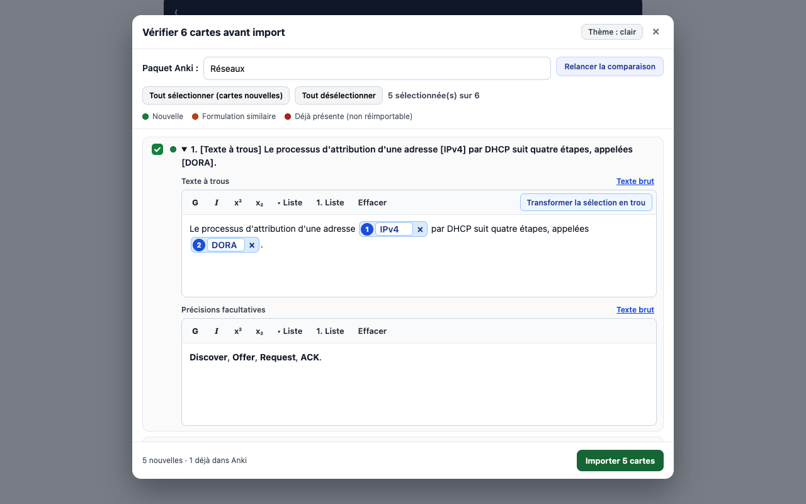
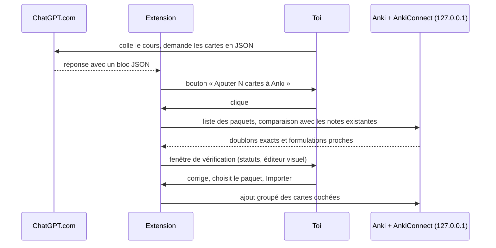

<div align="center">

[](README.en.md)


# Cartes vers Anki

**Importe dans Anki les cartes générées par ChatGPT, en un clic.**<br>
Un bouton apparaît sous la réponse, tu vérifies les cartes, les doublons sont repérés avant l'import. Tout reste sur ton ordinateur.

[](LICENSE)
[](https://chromewebstore.google.com/detail/fhkabgkbnknihhdlmcnkmnbijepclipi)
[](extension/manifest.json)
[](#prérequis)
[](https://github.com/pyxl-dev/cartes-vers-anki/actions/workflows/tests.yml)

</div>

<p align="center"></p>

## Pourquoi

Demander des cartes de révision à ChatGPT est facile. Les mettre dans Anki l'est moins : copier du JSON, vérifier chaque carte, deviner lesquelles existent déjà, retrouver le bon paquet.

Cartes vers Anki fait ce trajet à ta place. L'extension repère les cartes dans la réponse, te laisse les relire et les corriger, compare avec ta collection, puis les envoie dans le paquet de ton choix.

## Comment ça marche



- **Un bouton sous la réponse de ChatGPT** : « Ajouter N cartes à Anki », sans copier-coller de JSON.
- **Doublons détectés avant l'import** : exacts (toute la collection) et formulations proches (comparaison locale, sans IA).
- **Relecture et correction** dans un éditeur visuel, textes à trous compris.
- **Choix ou création du paquet** avec recherche tolérante aux accents.
- **100 % local** : l'extension ne parle qu'à AnkiConnect sur `127.0.0.1`. Pas de serveur, pas de compte, pas de télémétrie.

## Installation

Le plus simple : installer [Cartes vers Anki depuis le Chrome Web Store](https://chromewebstore.google.com/detail/fhkabgkbnknihhdlmcnkmnbijepclipi) (Chrome, Brave, Edge). Les mises à jour sont automatiques. Il faut aussi Anki et son greffon AnkiConnect, voir les prérequis plus bas.

Il n'y a pas d'installateur en ligne de commande : une extension se charge dans le navigateur, soit depuis le Chrome Web Store, soit à la main (méthodes ci-dessous).

<details>
<summary>Autres méthodes : kit bêta macOS, installation manuelle</summary>

Ces méthodes ne servent qu'à tester une version pas encore publiée.

**Kit bêta macOS.** Suivre le guide hors ligne [00 - INSTALLER SUR MAC.html](00%20-%20INSTALLER%20SUR%20MAC.html), puis double-cliquer `macos/Installer Cartes vers Anki.command`. L'installateur n'étant pas signé par Apple, macOS le bloque au premier lancement : cliquer **« Terminé »**, puis autoriser dans ** → Réglages Système → Confidentialité et sécurité → « Ouvrir quand même »**. Le projet ne contourne aucune protection. Détails et dépannage : [macos/LISEZ-MOI.md](macos/LISEZ-MOI.md).

**Installation manuelle.** Télécharger le dépôt dans un dossier permanent, ouvrir `chrome://extensions`, activer le **Mode développeur**, puis **Charger l'extension non empaquetée** → dossier `extension/`.

</details>

### Laisse ton agent IA s'en occuper

Colle ceci dans Claude Code, Codex, Cursor ou n'importe quel agent qui a accès à un terminal :

```text
Aide-moi à installer et utiliser Cartes vers Anki : https://github.com/pyxl-dev/cartes-vers-anki
Suis le fichier AGENTS.md de ce dépôt.
```

[`AGENTS.md`](AGENTS.md) explique à l'agent ce que fait l'extension, comment la mettre en place (y compris ce qu'il ne peut pas faire à ta place, comme charger une extension dans ton navigateur), comment la tester, et les règles de sécurité. Il est en anglais, la langue que tous les agents lisent.

### Prérequis

| | Sert à |
| --- | --- |
| [Anki Desktop](https://apps.ankiweb.net/) | recevoir les cartes (il doit être ouvert pendant la vérification et l'import) |
| Greffon **AnkiConnect** | dans Anki, `Outils → Greffons → Obtenir des greffons`, code `2055492159`, puis redémarrer Anki |
| Chrome, Brave ou Edge (bureau) | charger l'extension (testée sur Brave et Chrome) |
| Un compte ChatGPT | générer les cartes sur `chatgpt.com` ou `chat.openai.com` |
| [Node.js](https://nodejs.org) 22 | seulement pour lancer les tests (développement) |

## Utilisation

1. Ouvrir Anki, puis ChatGPT.com.
2. Coller ton cours et demander les cartes en JSON. Le bouton **« Préparer dans ChatGPT »** du popup insère un prompt prêt à l'emploi.
3. Cliquer **« Ajouter N cartes à Anki »** sous la réponse.
4. Vérifier, choisir le paquet, puis **« Importer »**.

Les cartes déjà présentes dans Anki sont décochées et ne sont jamais réimportées. Aucune note existante n'est modifiée sans action explicite.

Format attendu :

```json
{
  "cards": [
    { "type": "basic", "front": "Question", "back": "Réponse", "tags": ["medecine"] },
    { "type": "cloze", "text": "Le {{c1::terme}} est ...", "extra": "Précisions" }
  ]
}
```

Le guide complet ([docs/GUIDE.md](docs/GUIDE.md)) détaille la fenêtre de vérification, les textes à trous, les doublons, la mise à jour de notes, le format JSON, le changement de port d'AnkiConnect, le dépannage et les limites.

## Sécurité

- L'extension n'envoie aucune donnée à un serveur tiers : ses seules requêtes vont vers `127.0.0.1` (permission d'hôte unique, plus `storage`).
- Elle ne lit que les pages `chatgpt.com` et `chat.openai.com`.
- Aucune action destructive côté Anki : une note existante n'est mise à jour qu'après une case cochée et une confirmation explicites.
- Le texte de tes cours est en revanche envoyé à ChatGPT, comme tout message que tu y tapes : évite d'y mettre des données personnelles.
- Dans AnkiConnect, garde `webBindAddress` sur `127.0.0.1` et ne règle jamais `webCorsOriginList` à `["*"]`.

Politique complète : [PRIVACY.md](PRIVACY.md).

## Développement

```sh
git clone https://github.com/pyxl-dev/cartes-vers-anki && cd cartes-vers-anki
node tests/test.cjs            # tests de l'extension, hors navigateur, faux AnkiConnect local
bash tests/mac-beta-setup.sh   # tests du kit macOS, dans un bac à sable jetable
```

Pour charger l'extension depuis les sources, voir l'installation manuelle plus haut. Un tag `vX.Y.Z` lance les tests, construit le zip et le soumet au Chrome Web Store.

| Fichier | |
| --- | --- |
| `extension/` | l'extension chargeable (`manifest.json` à la racine) |
| `extension/content.js`, `cards.js` | détection du bloc JSON sur ChatGPT, lecture et validation des cartes |
| `extension/review.js`, `picker.js`, `rich.js` | fenêtre de vérification, choix de paquet, éditeur visuel |
| `extension/background.js`, `search.js`, `similarity.js` | appels AnkiConnect (service worker), lecture des notes, comparaison locale |
| `extension/popup.html`, `popup.js` | port, préparation du prompt, mode de secours |
| `macos/` | kit bêta : installer et mettre à jour par double-clic |
| `tests/` | tests de l'extension, du kit macOS et audit anti-fuite |
| `docs/GUIDE.md`, `docs/DEVELOPPEMENT.md`, `docs/PUBLICATION.md` | guide d'utilisation, structure du code, publication |
| `PRIVACY.md` | politique de confidentialité |
| `AGENTS.md` | instructions pour n'importe quel agent IA |

## Licence

[MIT](LICENSE)
