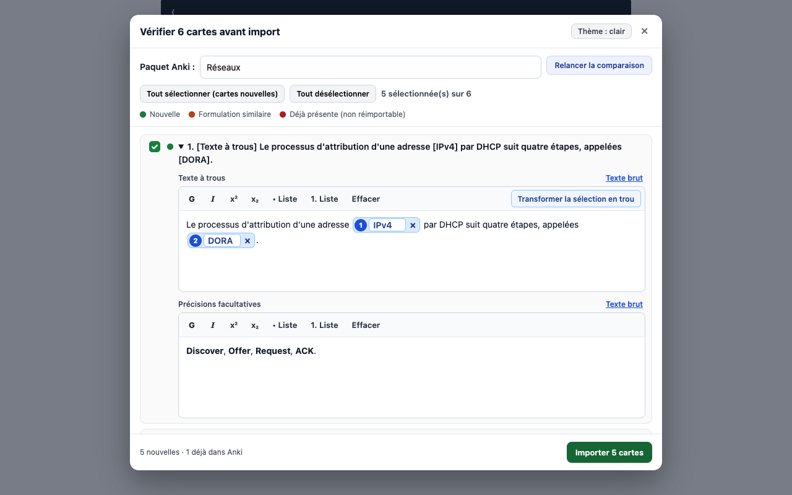

# Cartes vers Anki

Extension Chrome / Brave / Edge qui importe dans **Anki** les cartes de révision générées par **ChatGPT**, en un clic, avec détection des doublons.

[](https://chromewebstore.google.com/detail/fhkabgkbnknihhdlmcnkmnbijepclipi)
[](LICENSE)



## Fonctionnalités

- **Un bouton sous la réponse de ChatGPT** : « Ajouter N cartes à Anki », sans copier-coller de JSON.
- **Doublons détectés avant l'import** : exacts (toute la collection) et formulations proches (comparaison locale, sans IA).
- **Relecture et correction** dans un éditeur visuel, textes à trous compris.
- **Choix ou création du paquet** avec recherche tolérante aux accents.
- **100 % local** : l'extension ne parle qu'à AnkiConnect sur `127.0.0.1`. Pas de serveur, pas de compte, pas de télémétrie.

## Installation

**Prérequis**

1. [Anki Desktop](https://apps.ankiweb.net/)
2. Le greffon **AnkiConnect** : dans Anki, `Outils → Greffons → Obtenir des greffons`, code `2055492159`, puis redémarrer Anki.

**Extension** : installer [Cartes vers Anki depuis le Chrome Web Store](https://chromewebstore.google.com/detail/fhkabgkbnknihhdlmcnkmnbijepclipi). Les mises à jour sont automatiques.

<details>
<summary>Autres méthodes : kit bêta macOS, installation manuelle</summary>

Ces méthodes ne servent qu'à tester une version pas encore publiée.

**Kit bêta macOS.** Suivre le guide hors ligne [00 - INSTALLER SUR MAC.html](00%20-%20INSTALLER%20SUR%20MAC.html), puis double-cliquer `macos/Installer Cartes vers Anki.command`. L'installateur n'étant pas signé par Apple, macOS le bloque au premier lancement : cliquer **« Terminé »**, puis autoriser dans ** → Réglages Système → Confidentialité et sécurité → « Ouvrir quand même »**. Le projet ne contourne aucune protection. Détails et dépannage : [macos/LISEZ-MOI.md](macos/LISEZ-MOI.md).

**Installation manuelle.** Télécharger le dépôt dans un dossier permanent, ouvrir `chrome://extensions`, activer le **Mode développeur**, puis **Charger l'extension non empaquetée** → dossier `extension/`.

</details>

## Utilisation

1. Ouvrir Anki, puis ChatGPT.com.
2. Coller ton cours et demander les cartes en JSON. Le bouton **« Préparer dans ChatGPT »** du popup insère un prompt prêt à l'emploi.
3. Cliquer **« Ajouter N cartes à Anki »** sous la réponse.
4. Vérifier, choisir le paquet, puis **« Importer »**.

Les cartes déjà présentes dans Anki sont décochées et ne sont jamais réimportées. Aucune note existante n'est modifiée sans action explicite.

Format attendu :

```json
{
  "cards": [
    { "type": "basic", "front": "Question", "back": "Réponse", "tags": ["medecine"] },
    { "type": "cloze", "text": "Le {{c1::terme}} est ...", "extra": "Précisions" }
  ]
}
```

## Documentation

- [Guide d'utilisation](docs/GUIDE.md) : fenêtre de vérification, textes à trous, doublons, mise à jour de notes, format JSON, dépannage, limites
- [Développement](docs/DEVELOPPEMENT.md) : structure du code, tests
- [Publication](docs/PUBLICATION.md) : mise en ligne sur le Chrome Web Store
- [Confidentialité](PRIVACY.md)

## Confidentialité

L'extension n'envoie aucune donnée à un serveur tiers : ses seules requêtes vont vers `127.0.0.1`. Elle ne lit que les pages `chatgpt.com` et `chat.openai.com`. Le texte de tes cours est en revanche envoyé à ChatGPT, comme tout message que tu y tapes : évite d'y mettre des données personnelles.

## Licence

[MIT](LICENSE)
